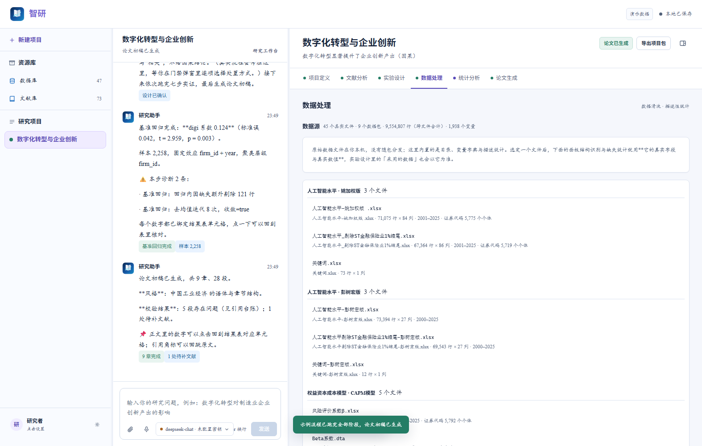
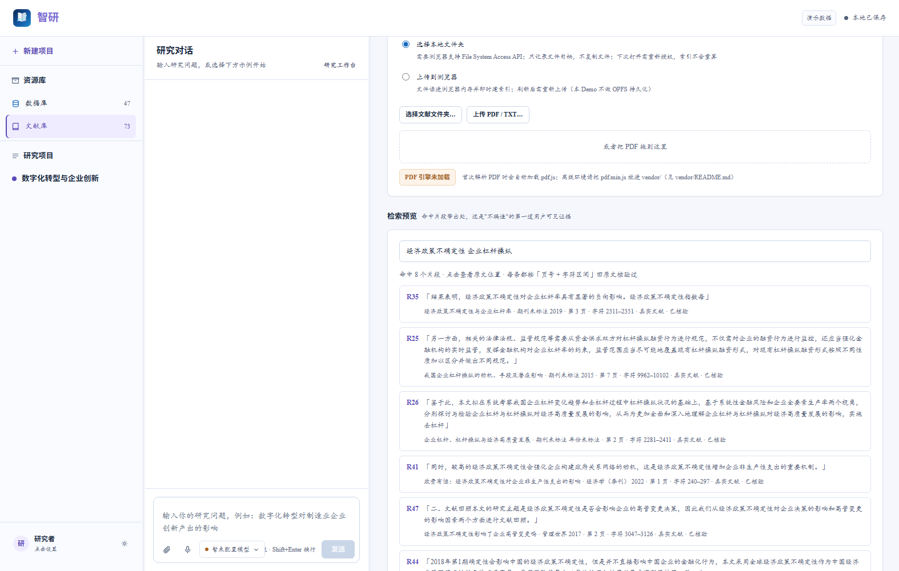
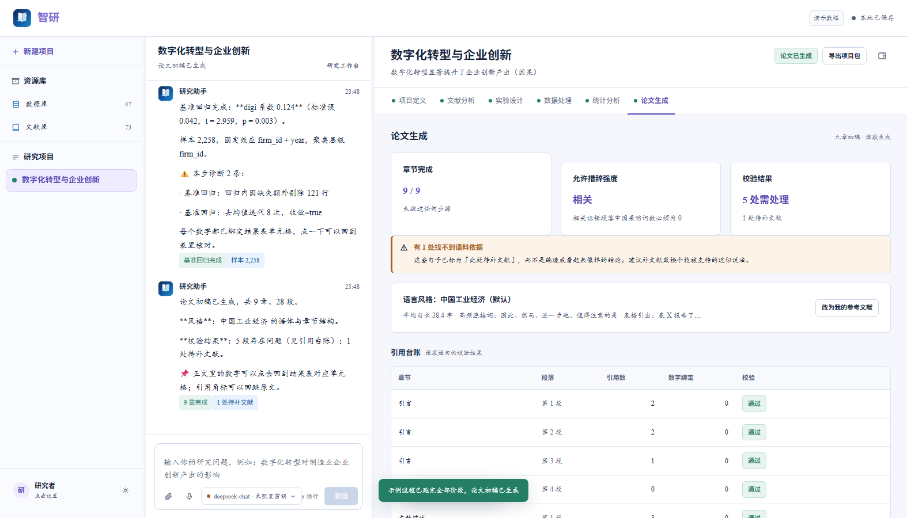
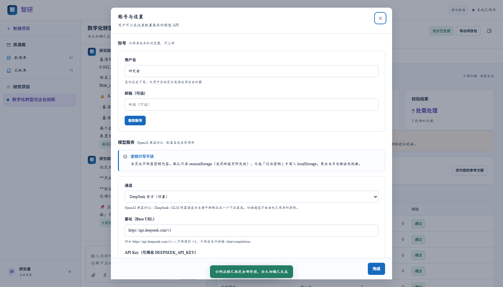

<div align="center">

# 智研 · 经管论文研究助手

**以你自己的文献库为知识底座，从研究想法走到一篇可投稿的论文。**

[🚀 在线体验](https://annaqueen01.github.io/zhiyan-demo/) · [设计文档](docs/) · [功能清单](#它能做什么)


</div>


## 这是什么

**智研**是一个面向经管类研究者的科研助手：把「选题 → 文献 → 实验设计 → 数据 → 计量 → 成稿」的完整流程摊开成一条可追溯的流水线，而不是给一段无法核验的文字。

本仓库是它的**纯前端高保真 Demo**：

- **零构建**：不用 npm、不用打包，浏览器直接加载源码；
- **零后端**：所有检索、计量、文档生成都在浏览器内完成；
- **零密钥也能演示**：内置示例项目可跑完整个 13 阶段流程；配置任意 OpenAI 兼容端点后，对话改走真实模型流式输出；
- **离线可用**：`file://` 双击 `index.html` 即可运行（内置 3.5MB 真实语料，不发网络请求）。

> 界面里的「演示数据」标签不是装饰：**虚构样例**与**真实文献/真实数据目录**在 UI 上分开标注，缺失的元数据一律显示「未标注」，不猜、不补。

## 在线体验 / 本地运行

| 方式 | 操作 |
|---|---|
| **在线** | 打开 <https://annaqueen01.github.io/zhiyan-demo/> |
| **本地（推荐）** | `python -m http.server 5173`，访问 <http://localhost:5173> |
| **直接打开** | 双击 `index.html`（Chrome / Edge 113+） |

> 想用「导出 Word」：额外运行 `python serve_docx.py`（只监听 127.0.0.1 的本地桥），或直接命令行 `python export_docx.py --in bundle.json --out 论文初稿.docx`。

## 界面速览

| 首页：一句话说清能做什么，直接输入研究问题 | 项目工作台：六阶段成果区 + 研究对话 |
|---|---|
|  |  |
| **真实数据目录：45 个文件按原目录归包，选定即用真值** | **文献检索：命中片段带页号与字符区间，可回原文逐字核验** |
|  |  |
| **论文生成：九章初稿、引用台账、逐句校验** | **模型配置：多通道、密钥只写不读、连通性检测** |
|  |  |

## 它能做什么

**六个阶段，一条主链**

1. **项目定义** — 命题五槽位解析、候选题目（带语料支撑度）、结论类型选择
2. **文献分析** — 语料体检报告、识别策略分布、三类探针、反向证据、章节缺口（`none` 不静默）
3. **实验设计** — 七分区（研究问题 / 假设 / 数据样本 / 变量 / 模型 / 检查清单 / 预期结果）+ **确认门**
4. **数据处理** — 数据源、面板结构识别、列类型与缺失统计、清洗日志、描述统计
5. **统计分析** — **七步实证流水线**，每步产出「可执行代码 + 结果文件 + 结果解读文件」三件套
6. **论文生成** — 九章初稿、风格包、引用台账、逐句校验、导出

**三条核心机制（这是演示里真正被硬编码保障的部分）**

- **实验设计确认门（唯一硬门禁）**：`design.confirmed` 写入前，执行器拒绝读取任何数据；修改设计会让确认**自动失效**。
- **结果解读数值一致性**：解读中的每个数字都绑定结果表 `cell_id`，校验失败降级为规则版，不放行。
- **措辞强度门控**：由 `claim_type` × 检查清单推导（弱工具变量场景锁定为「相关」），正文中因果动词数必须为 0。

## 内置的真实资源库

`scripts/library-real.js`（3.5MB）是离线内联的真实语料，检索不联网：

| 内容 | 规模 | 用它做什么 |
|---|---|---|
| 真实文献 | 51 个 PDF · 782 页 · 约 180 万字 | BM25 检索真实正文，命中片段给「页号 + 字符区间」，可回原文逐字核验 |
| 数据目录 | 45 个数据文件 · 955 万行（跨文件）· 1,938 个变量 | 挑数据、写变量度量、抄 do 代码；缺失率与均值/标准差来自真实数据 |
| 方法证据 | 18 份 do / 回归日志 / 结果文件 | 实验设计的「具体做法」直接引用，不凭空编 |

真实数据目录不是只躺在资源库里，而是**接进了流程**：数据处理页选定文件后，面板结构与变量字典换成该文件真值；设计页按真实字段生成并要求 `data` 写真实文件名；生成后逐行回核，出现目录里没有的文件名会标红「⚠ 数据目录里没有这个文件名」。

## 真实能力 vs 边界（诚实版）

| 能力 | 状态 |
|---|---|
| 全链路流程、13 阶段状态机、确认门、质量门 | ✅ 真实实现 |
| 引用校验（四查）、措辞强度机器校验 | ✅ 真实实现 |
| **计量引擎：OLS + 多维固定效应 + 聚类标准误** | ✅ 真实实现（62 项数值对拍） |
| **七步实证流水线接到真实计量引擎** | ✅ 真实计算（27 项验证，浏览器内实测 96–586ms/步） |
| **中文 BM25 + RRF 融合检索、页号/字符区间引用** | ✅ 真实实现（bigram 分词，离线可跑） |
| PDF 解析 / 分块 / 建索引 | ✅ 本机预抽取内置；浏览器端上传走 pdf.js（需 `vendor/pdf.min.js`，见 [vendor/README](vendor/README.md)） |
| 导出 .docx（三线表 / 双字体 / 披露章节） | ✅ 真实实现（22 + 27 项验证） |
| 模型真实调用（SSE 流式 + 错误分流 + 模型发现） | ✅ 真实实现（需自备密钥） |
| 数据文件本身 | ⏳ 未内置（单个 `.dta` 最大 919MB）；内置的是目录、变量字典与描述统计 |
| 向量检索 / OCR / 事件研究 / DiD / RDD / PSM | ⏳ 未做（各模块 docs 里有未做清单） |

> 界面上的**演示文案**是样例，但**计算结果不是**：点开七步任意一步，表格里每个数字都由 `scripts/econ.js` 现场算出，并附带可复现信息（样本量、固定效应、聚类层级、随机种子、代码指纹）。算不出来时返回 `SINGULAR` / `TOO_FEW_OBS` / `TOO_FEW_CLUSTERS`，UI 如实展示，不静默给假结果。

## 目录结构

```
.
├─ index.html                 入口（双击即可运行）
├─ styles/                    设计令牌 / 布局 / 组件
├─ scripts/                   应用、引擎、渲染与六个阶段页
│  ├─ library-real.js         ★ 真实语料（3.5MB，自动生成，勿手改）
│  ├─ pipeline.js             ★ 七步实证流水线
│  ├─ econ.js                 ★ 计量引擎（OLS / FE / 聚类 SE）
│  ├─ bm25.js · corpus.js     ★ 检索（bigram BM25 + RRF）
│  └─ stages/                 六个阶段页
├─ assets/                    品牌标识
├─ vendor/                    pdf.js 离线放置位（见 README）
├─ export_docx.py             命令行导出 Word
├─ serve_docx.py              仅回环地址的导出桥
├─ test/                      流水线 / 检索 / UI 修订自测
├─ screenshots/               界面截图
└─ docs/                      设计文档（PRD、实现规格、附录、验收矩阵…）
```

## 设计文档

本仓库不只放了 Demo，也完整公开了它的设计过程：

| 文档 | 内容 |
|---|---|
| [产品设计 PRD](docs/PRODUCT-PRD.md) | 信息架构、两态布局、交互与状态、验收口径 |
| [VibeCoding 实现规格](docs/VIBECODING-SPEC.md) | 逐模块实现契约（阶段、引擎、渲染、资源库、模型通道） |
| [架构评审](docs/ARCH-REVIEW.md) | 前端架构决策与取舍 |
| [附录 A · Agent 框架一致性契约](docs/APPENDIX-A-AGENT-CONTRACT.md) | 阶段-产物-门禁的一致性约束 |
| [附录 B · 阶段-产物-进度模型](docs/APPENDIX-B-STAGE-ARTIFACT.md) | 13 阶段状态机与产物模型 |
| [附录 C · 进度与可观测语义](docs/APPENDIX-C-OBSERVABILITY.md) | 进度条/日志语义 |
| [附录 D · 验收与测试矩阵](docs/APPENDIX-D-ACCEPTANCE.md) | 验收项与测试映射 |
| [作品介绍](docs/PROJECT-INTRO.md) | 项目背景、一句话介绍 |
| [一页纸决策卡](docs/DECISION-CARD.md) | 关键设计与取舍清单 |
| [七步流水线集成](docs/PIPELINE-INTEGRATION.md) | 流水线接口与数值一致性约定 |
| [检索口径](docs/RETRIEVAL.md) | 分块、BM25/RRF 口径与「未做向量检索」的边界 |

## 技术要点

- **零构建 vanilla JS**：只有一个 `index.html` + 原生 ES 脚本，没有框架、没有打包器，便于审计与离线分发。
- **计量引擎**：精确去均值 + 多维交替投影（如实报告迭代次数与是否收敛）；聚类标准误带有限样本校正，`G < 2` 拒绝估计；VIF**先去均值再算**。
- **检索**：字符 bigram + 英文词混合分词，索引侧与查询侧规则不同；BM25（k1=1.5, b=0.75）+ 元数据 BM25 与查询覆盖率的 RRF 融合（k=60）；每条结果带 `page` 与 `charRange`，`原文.slice(charRange) === quote` 有单测。
- **PDF 引擎三级加载**：注入/预载 → 本地 `vendor/pdf.min.js` → CDN，全部不可用时优雅降级并说明原因。
- **模型通道**：预置 DeepSeek 与 GLM 两个通道，可添加任意 OpenAI 兼容路由；密钥只写不读，默认 `sessionStorage`；错误分流用稳定错误码（`AUTH` / `QUOTA` / `RATE_LIMIT` / `TRANSPORT`…），不靠解析报错文本。

## 关于演示数据

演示数据分两类，界面上分开标注：

- **内置样例**（22 篇）是虚构的，只为演示流程；
- **真实文献**（51 篇）与**真实数据目录**（45 个文件）来自本机 `测试用` 目录，引用可回原文逐字核验。

真实资源里缺的元数据一律显示「未标注」，不猜：2 个 PDF 文本层是字形码 → 标「仅提及」；31 篇无期刊名、26 篇无年份 → 显示「未标注」；8 个超大文件只按前 2000 行算统计量并在表内标注。

## 说明

- 本仓库是**作品的可运行演示**（前端演示版本），不是完整产品；完整后端不在本仓库。
- 仓库中的 `scripts/library-real.js` 为自动生成的语料内联文件，请勿手工编辑。
- 界面为中文，桌面优先；小屏（< 880px）下项目栏折叠为横向选择器。

